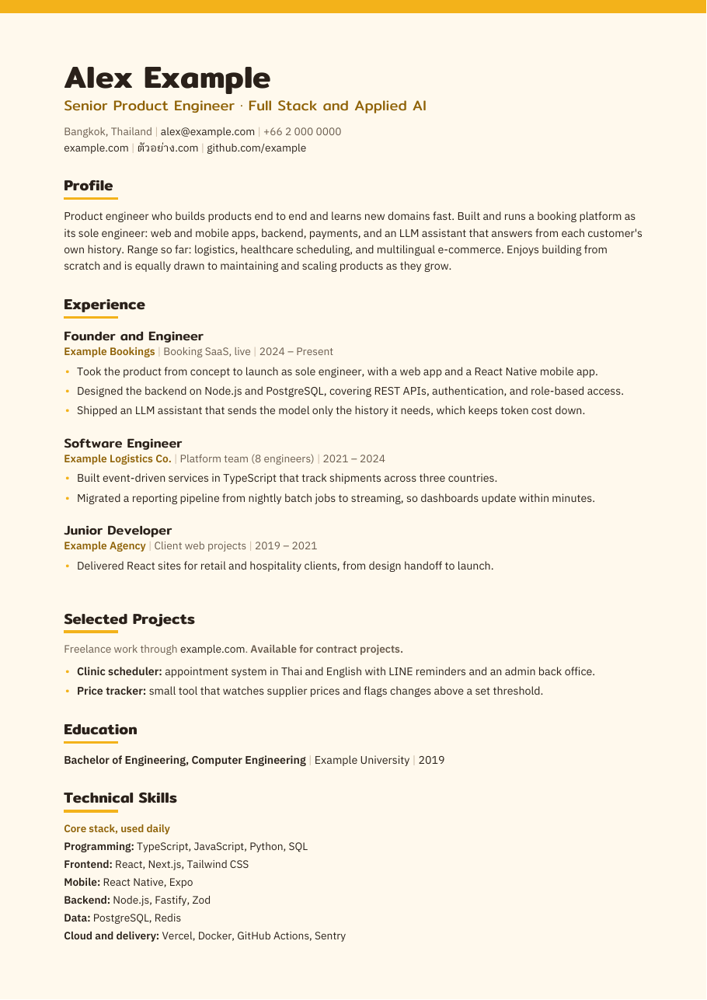

# cv-templater

Write your CV in one YAML file, get a clean PDF that applicant-tracking systems
(ATS) and AI screeners read correctly. Ships with **pooh**, a warm theme with
cream paper, honey accents, and fonts that cover both English and Thai.



## Why

Most CV templates look good and parse badly: two-column layouts, dates in a
right-hand column, text inside images. Parsers then pair a date with the wrong
job or drop your skills. This builder keeps the parts a machine reads strictly
linear, and puts the design in colour, type and spacing instead.

- One column of real text. Decoration (page colour, top band, logo) never enters the text layer.
- Each job's dates sit on its company line: `Company | team | 2021 – 2024`.
- Standard section headings, so parsers know where Experience and Skills start.
- Links show the address itself, because parsers drop link targets.
- Non-Latin domains like `ตัวอย่าง.com` are linked through their punycode form, so they open when clicked.
- Skills can be split into a primary tier and a smaller secondary tier. Both are plain text, so keyword matching sees everything.

## Quick start

```bash
git clone https://github.com/stateless-x/cv-templater.git
cd cv-templater
python3 -m venv .venv
.venv/bin/pip install -r requirements.txt
.venv/bin/python build.py examples/example.yaml
```

The PDF lands in `output/`.

## Make your own

```bash
cp examples/example.yaml my-cv.yaml   # my-cv*.yaml is git-ignored, so it stays private
.venv/bin/python build.py my-cv.yaml
.venv/bin/python check.py my-cv.yaml output/Your_Name_CV_<version>.pdf
```

`check.py` reads the PDF the way an ATS does and fails if anything is off: page
count, every contact line, each job's company and dates on one line, every
heading, leftover `[placeholders]`, and any words you list under `checks.banned_terms`.
It needs poppler (`brew install poppler` or `apt install poppler-utils`).

## The YAML

Every section has a `title` and one of these shapes:

| Shape | Use it for | Keys |
|---|---|---|
| `text` | Profile, Education | one paragraph |
| `jobs` | Experience | `role`, `company`, `about`, `dates`, `bullets` |
| `items` | Projects | optional `intro`, then bullets |
| `tiers` | Skills | each tier has `name` and `rows`; the first tier is full size, later tiers are smaller |
| `inline` | Spoken languages | a short list on one line |

Inside any text: `**bold**`, `[link text](example.com)`, and ` | ` for a soft separator.

Optional top-level keys: `version` (goes in the file name), `output`, `logo`
(a square PNG for the top right of page 1), `keywords` (PDF metadata), and `theme`.

## Themes

A theme is a folder in `themes/` with a `theme.json` (colours, fonts, sizes,
spacing) and its font files. To make one, copy `themes/pooh`, change the values,
and set `theme: your-theme` in your YAML.

## Licence

Code: MIT, see [LICENSE](LICENSE). The bundled fonts, Mitr and IBM Plex Sans Thai
Looped, are under the SIL Open Font License; their licence files are in
`themes/pooh/fonts/`.
